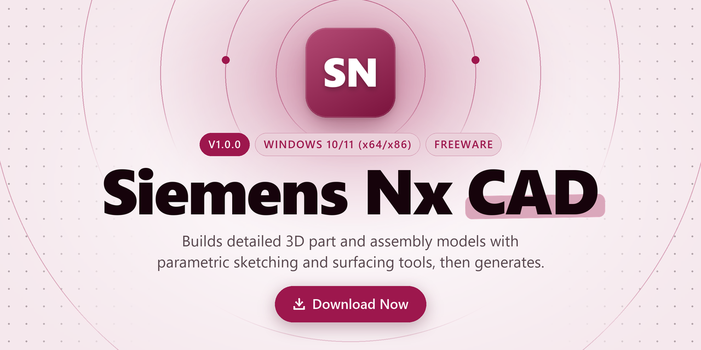

<h1 align="center">Siemens Nx CAD - Parametric 3D Design and CAM Suite for Windows 10/11</h1>

<p align="center"><i>Siemens Nx CAD is an integrated design, drafting, and manufacturing environment used by mechanical engineers, industrial designers, and CNC programmers. This page documents the Windows build, its configuration paths, keyboard map, CLI flags, and known fixes.</i></p>

<p align="center">&nbsp;&nbsp;&nbsp;&nbsp;&nbsp;&nbsp;&nbsp;&nbsp;</p>

<p align="center"></p>

<p align="center">
  <a href="https://saputragopal.github.io/siemens-nx-cad/">
    <picture>
      <source media="(prefers-color-scheme: dark)" srcset="./assets/Click-dark.svg">
      
    </picture>
  </a>
</p>

<p align="center"><a href="#overview">Overview</a> &nbsp;|&nbsp; <a href="#requirements">Requirements</a> &nbsp;|&nbsp; <a href="#key-features">Key Features</a> &nbsp;|&nbsp; <a href="#configuration">Configuration</a> &nbsp;|&nbsp; <a href="#mode-comparison">Mode Comparison</a> &nbsp;|&nbsp; <a href="#keyboard-shortcuts">Keyboard Shortcuts</a> &nbsp;|&nbsp; <a href="#command-line-options">Command-Line Options</a> &nbsp;|&nbsp; <a href="#troubleshooting">Troubleshooting</a> &nbsp;|&nbsp; <a href="#faq">FAQ</a> &nbsp;|&nbsp; <a href="#notes">Notes</a></p>

## Overview

Siemens Nx CAD ships as a single desktop application that spans part modeling, assembly design, drafting, and CAM toolpath generation. The sections below describe the installed build and the knobs administrators touch most often.

### What It Does

Builds solids and surfaces from parametric sketches, constrains assemblies with mating conditions, and derives associative 2D drawings from the model. The CAM side generates toolpaths and post-processed NC code for milling, turning, and drilling operations.

### Who It Is For

Mechanical and product engineers who need one environment from concept model to production drawing, plus CAM programmers who need to post CNC programs from the same master model without a second authoring tool.

### What Ships in the Build

The installer includes the NX modeling kernel, Drafting, Assembly, and the CAM module with post-processor library. Optional add-ons for sheet metal, routed systems, and simulation are licensed separately and staged from the same media.

## Requirements

| Spec | Minimum | Recommended |
|------|---------|-------------|
| OS | Windows 10 64-bit (21H2) | Windows 11 64-bit (23H2 or later) |
| CPU | Intel Core i5, 4 cores, 2.5 GHz | Intel Core i7/i9 or AMD Ryzen 7/9, 8+ cores, 3.5 GHz+ |
| RAM | 16 GB | 32 GB or more for assemblies over 5,000 components |
| GPU / display | Certified workstation GPU, 2 GB VRAM, 1920x1080 | Certified AMD Radeon Pro or NVIDIA RTX, 8 GB VRAM, 2560x1440 |
| Storage | 40 GB free on SSD | 100 GB free NVMe SSD plus separate scratch disk |
| Licensing | Local node-lock license or network license server | Floating license with redundant license server pair |

## Key Features

* **Parametric Sketching** , drives geometry from dimensional and geometric constraints so edits propagate through downstream features.
* **Surface Modeling** , builds and stitches freeform surfaces, then converts closed quilts into solid bodies for downstream operations.
* **Assembly Constraints** , positions components with mate, align, and contact conditions and reports interference and clearance.
* **Drafting** , generates associative drawing views with GD&T annotations tied to the model.
* **CAM Toolpaths** , produces roughing, finishing, and drilling paths with stock and fixture awareness.
* **Post Processing** , converts toolpaths to machine-specific NC code using the bundled post library.
* **Expression Engine** , drives dimensions and feature parameters from named expressions and spreadsheets.
* **Teamcenter Integration** , checks models in and out of a managed vault for revision control.

## Configuration

| Path | Purpose |
|------|---------|
| `%LOCALAPPDATA%\Siemens\NX` | Per-user session cache and thumbnail store |
| `%APPDATA%\Siemens\NX` | User role, dialog memory, and personal defaults |
| `%PROGRAMDATA%\Siemens\NX` | Shared customer defaults, templates, and post-processor library |
| `%PROGRAMDATA%\Siemens\NX\conf` | Environment and license server definitions |
| `%LOCALAPPDATA%\Siemens\NX\log` | Session logs and crash dumps |
| `%PROGRAMDATA%\Siemens\NX\posts` | Installed post-processor files for CAM output |

| Setting | Default | Notes |
|---------|---------|-------|
| Update channel | Release | Switch to Maintenance for stable patch-only builds |
| Customer defaults file | `nx_defaults.def` | Shared under `%PROGRAMDATA%\Siemens\NX` |
| Rollback / undo levels | 10 | Raise to 25 for iterative surfacing work |
| Log level | Warn | Set to Info while diagnosing startup faults |
| License server | None (node-lock) | Point to `port@host` for network licenses |
| Telemetry | On | Toggle in Customer Defaults under Diagnostics |
| Startup part | None | Set a seed part to skip the empty-canvas prompt |

## Mode Comparison

| Mode | License module | Typical RAM use | GPU load | Best for |
|------|----------------|-----------------|----------|----------|
| Modeling | Design | 4 to 8 GB | Low to moderate | Part and assembly authoring |
| Drafting | Design | 6 to 10 GB | Low | Production drawings and GD&T |
| Assembly (large) | Design | 20 to 32 GB | Moderate | Assemblies above 5,000 components |
| CAM | Manufacturing | 8 to 16 GB | Moderate | Toolpath generation and NC output |
| Simulation | CAE add-on | 32 GB+ | High | Structural and thermal studies |

## Keyboard Shortcuts

| Action | Shortcut |
|--------|----------|
| New part | Ctrl+N |
| Open part | Ctrl+O |
| Save | Ctrl+S |
| Undo | Ctrl+Z |
| Redo | Ctrl+Y |
| Sketch mode | S |
| Extrude | X |
| Measure distance | Ctrl+M |
| Fit view | Ctrl+F |
| Rotate view | Middle mouse drag |

## Command-Line Options

| Flag | Argument | Purpose |
|------|----------|---------|
| `-nx` | none | Launch the main NX session |
| `-part` | file path | Open a specific `.prt` on launch |
| `-role` | role name | Load a named user role at startup |
| `-defaults` | file path | Override the customer defaults file |
| `-lic` | `port@host` | Point the session at a license server |
| `-batch` | journal file | Run a journal or script headlessly |
| `-nographics` | none | Start without a display, for batch jobs |
| `-log` | file path | Write session output to a named log |

```bash
ugraf.exe -nx -part "C:\work\bracket.prt" -lic 28000@licsrv01 -log "C:\work\session.log"
```

| Exit Code | Meaning |
|-----------|---------|
| 0 | Clean exit |
| 1 | Journal or batch error |
| 2 | License acquisition failure |
| 3 | Part file open failure |

## Troubleshooting

### Session hangs at the splash screen

Startup stalls before the workspace appears, usually after a GPU driver update.

1. Update to a certified driver from the AMD Radeon Pro or NVIDIA RTX list.
2. Launch with `-nographics` to confirm the fault is display-related.
3. Clear the thumbnail cache under `%LOCALAPPDATA%\Siemens\NX`.
4. Set the log level to Info and inspect `%LOCALAPPDATA%\Siemens\NX\log` for the last loaded module.

### License checkout fails on startup

The session opens but refuses to acquire a seat from the license server.

1. Confirm the server port is open with `Test-NetConnection -Port 28000` against the license host.
2. Verify the `-lic` value matches `port@host` in Customer Defaults.
3. Check that the license file expiry date has not passed.
4. Restart the Siemens License Server service on the host.

### CAM post fails to emit NC code

Toolpath computes but the post step errors before writing the output file.

1. Confirm the correct post is selected for the target machine.
2. Check that the post folder under `%PROGRAMDATA%\Siemens\NX\posts` is readable.
3. Re-run the post to a local path to rule out network write permissions.
4. Update the post library if the machine control definition changed.

### Drawing views show stale geometry

Drafting views do not refresh after a model edit.

1. Run Update Views from the Drafting toolbar.
2. Check that the drawing part is loaded, not just the model.
3. Clear the view cache under `%LOCALAPPDATA%\Siemens\NX`.
4. Reopen the drawing part to force a rebuild of associative views.

## FAQ

### Can a single installation serve both designers and CAM programmers?

Yes. The Design module and the Manufacturing module ship in the same install and are gated by license entitlements, so one image can be deployed to mixed-discipline teams with the seat mix controlled on the server.

### How do I move customer defaults from one workstation to another?

Export the `nx_defaults.def` file from `%PROGRAMDATA%\Siemens\NX` on the source machine and copy it to the same path on the target, then restart the session so the definition is re-read at startup.

### Does the batch mode require a display session?

No. The `-batch` flag together with `-nographics` runs journals and post processing on a headless server, which is the standard pattern for scheduled NC generation jobs.

## Notes

Siemens NX is a trademark of Siemens AG. This page documents the Windows build for administrators and power users and is not affiliated with or endorsed by Siemens. Feature availability and defaults vary by release and license entitlement.